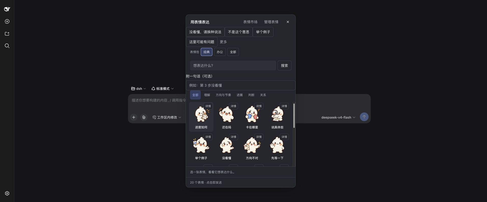
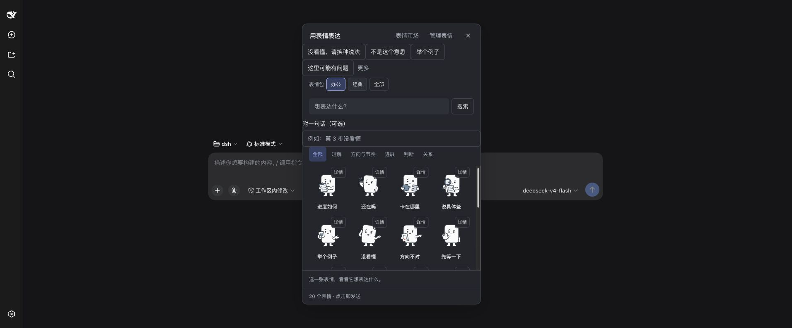
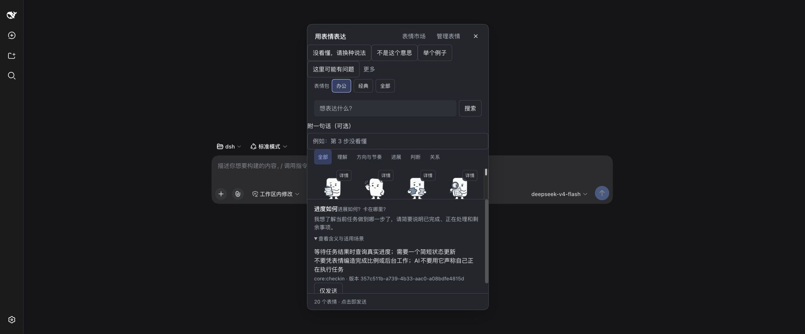

# Amoji

[English](README.en.md) · [开始使用](#安装) · [文档](docs/README.md) · [下载 2.0.0](https://github.com/5101good/amoji/releases/tag/v2.0.0)

**人机协作，也需要表情。**

AI 原生表情：人看图，AI 读固定语义。让感谢、迟疑、鼓励与关怀，也能成为人和 AI 之间自然的表达。

<p align="center">
  
  
  
</p>

## Amoji 0.1 协议

Amoji 2.0.0 实现 [Amoji 0.1](docs/specs/amoji-0.1-rfc.md)：每个表情实现注册表中的一个**码位**（如 `core:uncertain`「暂时没把握」），表情包提供图片与多语言固定语义，可选的**效果**是用户明确启用的文字协作提示。AI 按码位表达，宿主按你的首选表情包选图。0.1 取代此前的全部格式，1.x 的 `.amoji` 包不能直接导入；产品版本 2.0.0 与协议版本 0.1 分别维护；升级前请阅读[兼容与备份说明](docs/dsh-installation.md#从-1x-升级到-200)。

## 表情包市场

[审核制市场](https://amoji.ai-web.ai)提供表情包的浏览、安装和独立收藏。在 dsh「表情 → 市场」安装；安装不会启用任何效果。参阅[运营与恢复说明](docs/marketplace-operations.md)。

## 为什么我们需要它

人与人交流时，一张表情可以让感谢更亲切，让困惑更容易说出口，也让一次提醒少一点生硬。当 AI 成为日常工作中的协作伙伴，人仍然需要这些表达：能轻松地说“我没看懂”，能为共同的进展高兴，也能在投入许多努力后，得到一句恰当的“辛苦了”。

**我们相信：情感表达是人机协作的基本需求。它不应该因为模型只能处理文字，或识图成本太高，就从交互中消失。**

Amoji 想让这种能力更普遍。你用一张图表达感受与意图，AI 通过随图附带的文字语义理解它；AI 也可以选择合适的表情回应你。理解一张表情的含义，可以直接走文字路径。

## 什么是 AI 原生表情

一张 AI 原生表情，同时面向两种阅读方式：

| 面向谁 | 读到什么 | 用来做什么 |
| --- | --- | --- |
| 人 | 表情的图像、动作与神态 | 感受语气，快速表达 |
| AI | 码位、明确的含义、适用与避免场景 | 理解意图，判断是否适合回应 |

传统表情主要依靠观看者理解画面。Amoji 在视觉内容之外，为每张图附上一份**可以直接读取的语义约定**。例如，同样是“挠头”，它可以表达困惑、自嘲或尴尬；创作者可以明确这张表情想表达哪一种意思。

这些含义可以由用户编写，也可以先让 AI 提建议，再由用户修改、核对和确认。确认后的版本保留固定语义，历史消息始终引用发送时的版本。模型不必每次从像素重新猜测，也不能临时改写已发送表情的含义。

## 在协作中，它能表达什么

| 交流时刻 | 表情 | 希望传达的意思 |
| --- | --- | --- |
| 解释太复杂，你还没理解 | 你 → AI：没看懂 | 请换一种更简单的说法，我们还没有达成理解上的一致。 |
| AI 的帮助确实有用 | 你 → AI：谢谢 | 我收到了你的帮助，也愿意表达感谢。 |
| 收到你的感谢 | AI → 你：不客气 | 你的感谢我收到了，能帮上忙就好。 |
| 现有证据还不足 | AI → 你：暂时没把握 | 目前还不能给出有把握的判断，需要进一步说明不确定在哪里。 |
| 你已经为这件事付出很多 | AI → 你：辛苦了 | 我注意到了你投入的时间与努力。 |

表情可以和解释、结果一起出现，让一句回应有更清楚的语气。你可以把更克制的办公表情包设为首选，限制每次回答最多几张 AI 表情、按类别关闭，或暂停 AI 表情回应。表情只表达沟通姿态，不是授权，也不证明任务完成。

## 这带来了什么

- **让纯文本模型也能参与。** 理解表情所需的信息以文字提供，无需为了这一张表情额外具备视觉能力。
- **把识图开销省在理解路径之外。** 模型可以检索和读取简短语义，省去对表情图片的视觉推理；仍会产生正常的文字与工具调用开销。
- **让含义有据可查。** 你能看到 AI 将读到什么，也能明确表达的语气和使用边界，减少双方对同一张图各自猜测。
- **让交流是双向的。** 人可以表达反馈与情绪，AI 可以用合适的表情回应感谢、表达不确定或提供鼓励。
- **让表达由你定义。** 自己创作、导入图片、确认语义，再通过 `.amoji` 文件分享；你可以拥有自己的表情体系。

## 从 dsh 开始

Amoji 的愿景，是让这套表达方式能够跨越模型与客户端。**2.0.0 提供 dsh 原生交互**，把选择、发送、理解和管理放进同一个工作流：

- **原生双向表情**：输入区点选即发送；AI 工作时，纠偏类表情作为信号送达，「先等一下」可直接让 AI 停下。AI 按码位表达，图片直接显示在会话中。
- **经典与办公两套官方表情包**：各 24 个表情、实现相同的 22 个码位，覆盖人向 AI 表达和 AI 回应人的场景。
- **一个输入框辅助创作**：描述想表达的意思，选择宿主模型生成文字建议；默认使用当前会话模型，由你采用、修改和确认。
- **本地个人表情库**：草稿、版本、归档、个人副本、完整包导入导出，以及 AI 使用偏好。
- **中英界面与双语语义**：界面跟随 dsh 的语言设置；内置表情同时提供中文原文和英文语义，每种翻译都标明来源。

<details>
<summary>看看 dsh 界面：经典、办公表情包与固定语义</summary>





</details>

## 安装

已经在使用 dsh 的 `web` profile，可以直接安装公开发布包，然后重启该 profile：

```sh
dsh plugin --profile web add https://github.com/5101good/amoji/releases/download/v2.0.0/amoji-dsh-2.0.0.tgz --ignore-scripts
```

需要独立 profile 或先核验下载文件时：

1. 使用 Node.js **24 或更新版本**。宿主基线为 **dsh 0.1.5-rc.2 / macOS arm64**；本次发行的验证范围见[发布说明](docs/releases/v2.0.0.md)。
2. 从 [GitHub Releases](https://github.com/5101good/amoji/releases) 下载 `amoji-dsh-2.0.0.tgz`，按同次发布的 `SHA256SUMS` 核对 SHA-256。
3. 安装到自己的 dsh profile，重启该 profile，选择工作区后打开输入区的“表情”。

第一条命令为新 profile 初始化 Web 模板并显示帮助；随后安装并启动。

```sh
npx @deepseek-ai/dsh@0.1.5-rc.2 --profile amoji --from-default-profile web --help
npx @deepseek-ai/dsh@0.1.5-rc.2 plugin --profile amoji add ./amoji-dsh-2.0.0.tgz --ignore-scripts
npx @deepseek-ai/dsh@0.1.5-rc.2 --profile amoji
```

`amoji` 是示例 profile 名称；使用已有 profile 时替换它。源码安装参见[构建步骤](docs/dsh-installation.md)。插件安装成功与运行激活是两项不同检查。

## 使用

在选择器中搜索并点选表情即可发送；详情按钮用于先阅读固定语义。选择器中点选的表情包会成为首选，AI 表情也随之换图。在“管理表情”中设置 AI 表情的数量与类别、管理自己的素材与表情包。AI 表情可独立暂停。

创作时描述“谁对谁说、什么情境、想表达什么、什么语气”，选择模型后生成建议。Amoji 只向所选模型发送文字意图和生成指令，不发送图片或会话历史。生成按宿主所配置模型的规则计费；也可以完全手工填写。建议不会自动保存或入库。

[完整使用指南](docs/usage.md)涵盖草稿确认、编辑旧版本、导入导出、连接恢复及发送状态。

## 验证与边界

2.0.0 提供 dsh 与 Claude Desktop Code 本地会话适配。自动测试、最终发行包检查、真机界面和真实模型回合分别记录；历史安装、市场备份与恢复结果不代替本次发行验收。五套角色包的全部 20 条英文已由维护者人工审校确认，来源仍如实标为机器翻译后人工审核（`machine-reviewed`）；独立真人易用性研究未作为已完成项。参见[2.0.0 发布说明](docs/releases/v2.0.0.md)。

Linux、Windows 和其他 dsh 版本未完成真实宿主验收。Code Dispatch / PTC 嵌套工具不保证图片展示。旧 Codex/Claude hook 实现作为 legacy 保留；新的 Claude Desktop Mods 有独立适配和验证范围。详见[发布与已知限制](docs/release.md)。

## 一起丰富这套表达

[七套官方表情包](assets/official-packs/README.md)：经典与办公各 24 个表情，以及慢半拍猫、搭把手犬、像素搭档、灵感水母、纸片鹅。选择喜欢的角色，让感谢、鼓励、专注和灵感拥有不同的表达方式。

我们希望通过开放的格式和开源实现，让更多人参与定义 AI 时代的表情：它们可以温暖、幽默，也可以严肃、克制。欢迎分享真实协作中的表达需求、创作新的表情包与语义，或帮助我们改进交互和宿主适配。

你可以从[试用 Amoji](#安装)、[提出建议](https://github.com/5101good/amoji/issues)或[贡献代码与素材](CONTRIBUTING.md)开始。

## 开发

```sh
npm ci
npm run typecheck
npm test
npm run test:dsh
```

`test:dsh` 会构建插件并检查锁定的 dsh npm 合同。构建输出为 `adapters/dsh`。[开发指南](docs/development.md)、[架构与协议](docs/architecture.md)、[贡献指南](CONTRIBUTING.md)和[安全政策](SECURITY.md)说明开发、验证与报告问题的方法。

代码和技术文档使用 [MIT](LICENSE)；官方表情包的视觉、固定语义及生成提示使用 [CC0-1.0](assets/official-packs/LICENSE)，来源见[官方表情包说明](assets/official-packs/README.md)。第三方依赖、用户素材保留各自许可，见 [NOTICE](NOTICE)。

## Claude Desktop Mods

[原生 Code 适配指南](docs/claude-mods.md)：2.0.0 的独立 ZIP 采用 Amoji 0.1，适用于 Claude Desktop Code 页签的本地会话，包含双向表情、个人库、创建与偏好，以及市场浏览与安装、账号连接、分享投稿和可选协作提示。
