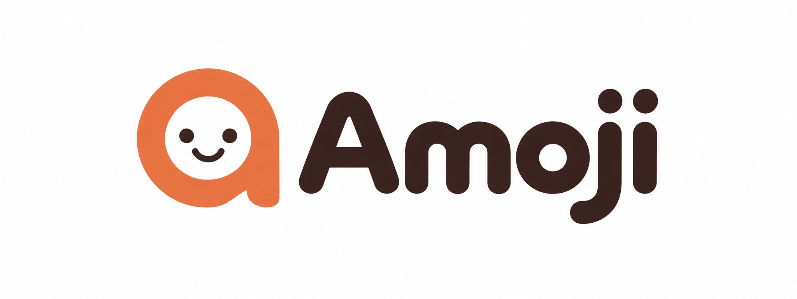

# Amoji 品牌素材

## 当前选用的 logo

当前选用「微笑 a」作为 Amoji logo。

- 主文件：[`amoji-logo.png`](amoji-logo.png)
- 格式：PNG，2048 × 768，白色背景。
- 设计：小写 a、对话气泡与笑脸融合，暖橙图形配深棕字标。
- 来源：使用内置 image_gen 工具生成。
- 当前为栅格稿，尚无 SVG 矢量版或透明底版本。
