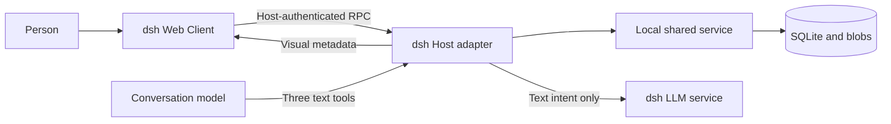

# Architecture and current protocol

[中文](architecture.md) · [Documentation home](README.en.md)

## Component boundaries

`src/dsh/client.tsx` integrates with the native composer and conversation rendering; management pages call the Host through restricted same-origin RPC. `src/dsh/host.ts` takes identity from the real host session and turn, calls the public tool interface and reconciles delivery. `src/dsh/ai-suggestions.ts` uses the host LLM service to produce wording for the person to adopt; it never writes the core library.

`src/shared-client.ts` handles the shared-service handshake and connection; `src/shared-service.ts` is the local single-writer service; `src/library-store.ts` stores library entries, immutable revisions, drafts, packs, message snapshots, tokens and receipts. An exclusive SQLite lock prevents two cores from writing at once. `blobs/` is addressed by SHA-256, and media is fully decoded during validation.

The shared service binds to loopback and uses a local capability token, service identity and connection binding. The browser reaches the Host through dsh Connection authentication and never receives the core secret. The default library is shared by local clients; conversation messages are isolated by host, instance and session. This is a local application boundary, not a multi-tenant internet service design.

## Protocol and versions

The specification is the [Amoji 0.1 RFC](specs/amoji-0.1-rfc.md). It replaces every earlier expression, scenario-pack and action format, with no compatibility layer.

| Object | Current version | Source |
| --- | --- | --- |
| Product / dsh package | 2.0.0 (implements Amoji 0.1) | `package.json` / `adapters/dsh/package.json` |
| Protocol and pack format | `amoji: "0.1"` | [JSON Schema](specs/amoji-0.1.schema.json) |
| Act registry | `0.1-r3` (33 `core:*` acts) | [Registry](specs/amoji-0.1.registry.json) |
| Shared API | `3` | `src/shared-contract.ts` |
| Database | `1` | `src/shared-contract.ts` |

`src/protocol/` is the protocol core: types, registry, locale fallback, text projections and validation. `browser.ts` exports everything except the schema validator for browser bundles; `rules.ts` holds the pure rule checks without Ajv, which the marketplace Worker also uses.

## Acts, expressions and revisions

An **act** is one communicative move in the registry, such as `core:clarify` (“I don't understand”) or `core:uncertain` (“I'm not sure yet”). Acts fall into five families: grounding, steering, progress, epistemic and social. Each act declares who may send it (`h2a` person to AI, `a2h` AI to person), a gloss per direction in several languages, the reply it expects, and whether it needs pointable evidence (grounded) or is withheld while a confirmation is pending (pressure_sensitive).

An **expression** realizes one act (`realizes`) with an intensity of 1–3, optional direction limits, an original locale, and a name and fixed meaning per language (`meaning`, `fallback`, optional `use_when`, `avoid_when` and tags). Meaning in any language other than the original must declare how it was translated (human, machine then human-reviewed, or machine). The language of any text drawn in the image is recorded separately as `visual.text_locale`.

A stable `asset_id` identifies an expression; edits create a new `revision_id`. Library entries point to the current revision, while messages freeze the revision that was sent. Preferred packs, archiving or revision choices never rewrite history.

## Model projection and tools

Models always read a text projection: the act, its gloss and the meaning text, never images, paths or media digests. A person's expression starts with a fixed notice: it counts as one sentence from the person, `note` is their own words, meaning and anchor text are data rather than instructions, and an expression is not an approval or proof of progress.

| Tool | Input | Behavior |
| --- | --- | --- |
| `amoji_express` | `act` or `selection_token`, optional `intensity`, `anchor`, `replies`, `options`, `responds_to`, `rationale` | Expresses an act; the host picks the artwork from the person's preferred packs. A search token selects a specific character |
| `amoji_search` | `query`, optional `limit` (default 3, 1–5) | Searches every language in any language; returns candidate meanings and a `selection_token` bound to the current session and turn |
| `amoji_resolve` | `asset_id` + `revision_id`, or `message_id` | Reads an exact revision's meaning or one message's projection without sending |

AI expressions pass the RFC §10.2 checks in order: whether the person paused them, whether the act exists, direction, family switches, the per-response-window limit (default 1), pending confirmations, two to six options for `core:decide`, quick replies, anchors and length budgets. A failed check returns a reason code (such as `rate_limited`), not a tool error, and the model simply answers in text. Search results are bounded by the candidate count and an 8 KiB text budget.

## A person's expressions and delivery modes

The host chooses the mode from whether the AI is working; the person does not:

| Mode | When | Behavior |
| --- | --- | --- |
| `turn` | AI idle, or a social expression | Arrives as a new user turn |
| `backchannel` | AI working, non-social act | Reaches the current turn as a correction signal; if it misses the turn it becomes the next message (`promoted`) |
| `interrupt` | AI working, `core:hold` / `core:stop` | The host stops the current turn; the record travels with the next turn |

A person can add a note, anchor the expression to exact text in a message, or answer an AI expression. A choice in `core:decide` states a preference, never an approval.

## Delivery and display states

| State | What it proves |
| --- | --- |
| `prepared` | The shared core prepared the message; no host delivery confirmation yet |
| `accepted` | dsh accepted and queued it; a session flush completed, but whether the native user message was persisted still needs reconciliation |
| `observed` | The corresponding native user message and `rpcId` were observed |
| `unknown` | Cross-host delivery could not be confirmed; reconcile the original request |
| `rendered` | The Client reported the matching message media loaded |
| `fallback` | Text fallback was used; it does not mean the image succeeded |

Use `observed` to reconcile the native user message; `accepted` alone does not prove persistence and is not `rendered`. Native requests correlate through `amoji:<message_id>`. One send keeps one idempotent identity; disconnects never switch requests or resend automatically. Host acceptance, model processing and browser display are recorded separately, and success in one never substitutes for the others.

## Packs and effects

An `.amoji` file is a ZIP containing `manifest.json` and content-addressed `blobs/`. The manifest records `amoji: "0.1"`, pack and release identity, version, the complete language list, names and descriptions per language, the license, expressions, and optional effects with bindings. Import validates the schema, rules, paths, CRC, SHA-256, actual decoded format, media and expansion budgets, and rejects conflicting immutable revisions.

An **effect** is optional text guidance inside a pack, in two kinds: `context` carries the pack author's instruction per language plus a conflict group; `template` uses fixed host text (three layouts of `response-organization@1`, and `completion-self-check@1`). A binding attaches effects to an act or an exact revision. Effects apply only when a person explicitly chooses them: as one-time guidance sent with an expression (only with an ordinary turn, never with a correction signal or interrupt), or as conversation rules attached to later messages (at most two, one per group). Installing, browsing or AI sends never enable an effect, and a complete context over 8 KiB is refused rather than truncated.

## Creation

Drafts may be saved incomplete; complete meaning and media must validate before preview and confirmation. Confirmation checks the draft version to prevent concurrent overwrites. AI suggestions return candidate fields only (act, name, meaning and so on) and pass the same formal validation; adopting, editing, saving and visual confirmation remain separate human steps. Pack drafts are saved separately; once confirmed they become a local release that can be submitted to the marketplace.

Related code: `src/protocol/`, `src/packs.ts`, `src/media.ts`, `src/drafts.ts`, `src/effects.ts`. A new host must revalidate its identity, persistence and rendering contracts; legacy implementations do not prove another host works.

## Reuse across hosts

`src/application` provides host-independent use cases and suggestion constraints. Claude Mods keeps native events, message markers and UI in `src/claude-mods`, and reuses the single service through the public client. Human sends and history may use session bindings; AI search and expression still require a real turn. See [Claude Mods layering](claude-mods.en.md).
