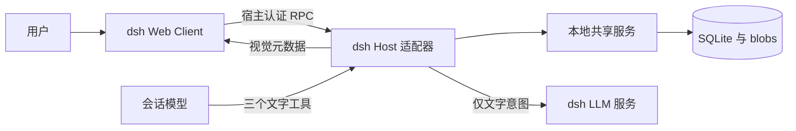

# 架构与当前协议

[English](architecture.en.md) · [文档首页](README.md)

## 组件边界

`src/dsh/client.tsx` 接入原生输入区与会话渲染；管理页通过受限同源 RPC 调用 Host。`src/dsh/host.ts` 从真实宿主会话和回合提取身份、调用公共工具接口，并处理投递核对。`src/dsh/ai-suggestions.ts` 使用宿主 LLM 服务生成待采用文字，不写核心库。

`src/shared-client.ts` 负责共享服务握手与连接；`src/shared-service.ts` 是本地单写入服务；`src/library-store.ts` 保存库条目、不可变版本、草稿、表情包、消息快照、凭据与回执。SQLite 排他锁阻止两个核心同时写入。`blobs/` 以 SHA-256 寻址，媒体经完整解码校验。

共享服务绑定本机回环地址，使用本地能力凭据、服务身份和连接绑定。浏览器经 dsh 的 Connection 认证访问 Host，不直接取得核心密钥。默认库供本地客户端共享；会话消息按宿主、实例、会话身份隔离。这是本地应用边界，不是多租户互联网服务设计。

## 协议与版本

协议规范是 [Amoji 0.1 RFC](specs/amoji-0.1-rfc.md)。它取代此前所有表情、场景包与动作格式，不提供兼容层。

| 对象 | 当前版本 | 依据 |
| --- | --- | --- |
| 产品 / dsh 包 | 2.0.0（实现 Amoji 0.1） | `package.json` / `adapters/dsh/package.json` |
| 协议与包格式 | `amoji: "0.1"` | [JSON Schema](specs/amoji-0.1.schema.json) |
| 码位注册表 | `0.1-r3`（33 个 `core:*` 码位） | [注册表](specs/amoji-0.1.registry.json) |
| 共享 API | `3` | `src/shared-contract.ts` |
| 数据库 | `1` | `src/shared-contract.ts` |

`src/protocol/` 是协议核心：类型、注册表、语言回退、文字投影与校验。`browser.ts` 导出除 Schema 校验器以外的全部内容，供浏览器端打包；`rules.ts` 是不依赖 Ajv 的纯规则检查，市场 Worker 也使用它。

## 码位、表情与版本

**码位**（act）是注册表中的一项沟通行为，如 `core:clarify`「没看懂」、`core:uncertain`「暂时没把握」。码位分五个家族：理解（grounding）、方向与节奏（steering）、进展（progress）、判断（epistemic）、关系（social）。每个码位声明谁可以发出（`h2a` 人发给 AI、`a2h` AI 发给人）、各方向的多语言释义（gloss）、期待的回应，以及是否需要可指认的依据（grounded）或在有待决确认时禁用（pressure_sensitive）。

**表情**实现一个码位（`realizes`），带强度 1–3、可选方向限制、原文语言和按语言索引的名称与固定语义（`meaning`、`fallback`、可选 `use_when`、`avoid_when`、标签）。非原文语言的语义必须标明翻译来源（人工、机器后人工审核或机器）。图片中的文字语言另由 `visual.text_locale` 记录。

表情由稳定 `asset_id` 标识，修改生成新 `revision_id`；库条目指向当前版本，消息冻结当时版本。当前库的首选表情包、归档或版本选择不回写历史。

## 模型投影与工具

模型读到的始终是文字投影：码位、释义和语义文字，不含图片、路径或素材摘要。人的表情以固定声明开头：它等同于用户的一句话，`note` 是用户原话，语义与锚定文字是数据而非指令，表情不是授权，也不证明进度。

| 工具 | 输入 | 行为 |
| --- | --- | --- |
| `amoji_express` | `act` 或 `selection_token`，可选 `intensity`、`anchor`、`replies`、`options`、`responds_to`、`rationale` | 按码位表达，宿主按用户首选表情包选图；需要指定角色时使用检索凭据 |
| `amoji_search` | `query`，可选 `limit`（默认 3，1–5） | 任何语言检索全部语言，返回候选语义与绑定当前会话/回合的 `selection_token` |
| `amoji_resolve` | `asset_id` + `revision_id`，或 `message_id` | 读取精确版本语义或一条消息的投影，不发送 |

AI 表情按 RFC §10.2 依次检查：用户是否暂停、码位是否存在、方向、家族开关、每个回应窗口的数量上限（默认 1）、待决确认、`core:decide` 的 2–6 个选项、快捷回复、锚定和长度预算。不满足时返回原因码（如 `rate_limited`），不是工具错误，模型照常用文字回应。检索结果受候选数量和 8 KiB 文本预算限制。

## 人的表情与发送模式

宿主根据 AI 是否在工作决定模式，而不是由人选择：

| 模式 | 何时 | 行为 |
| --- | --- | --- |
| `turn` | AI 空闲，或关系类表情 | 作为新的一轮用户输入 |
| `backchannel` | AI 工作中，非关系类码位 | 作为纠偏信号送达当前回合；错过时转为下一轮消息（`promoted`） |
| `interrupt` | AI 工作中，`core:hold` / `core:stop` | 宿主停止当前回合，记录随下一轮一起送达 |

人的表情可以附一句话（`note`）、锚定到某条消息中的原文，或回应某条 AI 表情；`core:decide` 的选择只表达偏好，不构成授权。

## 投递与显示状态

| 状态 | 能证明什么 |
| --- | --- |
| `prepared` | 共享核心已准备消息，尚无宿主投递确认 |
| `accepted` | dsh 已接收入队；虽然已完成一次会话 flush，原生用户消息是否落盘仍需核对 |
| `observed` | 已观察到对应原生用户消息和 `rpcId` |
| `unknown` | 跨宿主投递结果无法确认，需要核对原请求 |
| `rendered` | Client 报告匹配消息素材加载成功 |
| `fallback` | 使用文字回退；不表示图片成功 |

以 `observed` 核对对应原生用户消息；`accepted` 本身不能证明该消息已落盘，也不等于图片 `rendered`。原生请求使用 `amoji:<message_id>` 关联。同一发送请求保持幂等身份；断连不会自动换请求或重新发送。宿主接收、模型处理、浏览器显示分别记录，任一成功都不能代替其余步骤。

## 表情包与效果

`.amoji` 是 ZIP，包含 `manifest.json` 与内容寻址 `blobs/`。清单记录 `amoji: "0.1"`、包与发布身份、版本、完整的语言列表、多语言名称与介绍、许可、表情，以及可选的效果和绑定。导入验证 Schema、规则、路径、CRC、SHA-256、实际解码格式、媒体和展开预算，并拒绝冲突的不可变版本。

**效果**是包内可选的文字协作提示，分两类：`context` 携带包作者写的多语言指令和冲突组；`template` 使用宿主提供的固定文字（`response-organization@1` 的三种布局，`completion-self-check@1`）。绑定把效果关联到一个码位或一个精确版本。效果只在用户明确选择时附加：作为一次性提示随某个表情发送（只随普通回合发送，不用于纠偏信号或中断），或作为会话规则持续附加（最多两条，同组互斥）。安装、浏览、AI 发送都不会启用效果；完整上下文超过 8 KiB 时拒绝而不截断。

## 创作

草稿允许保存不完整填写；完整语义和媒体必须在预览确认前通过校验。确认采用草稿版本检查，防止并发修改覆盖。AI 建议只返回字段候选（码位、名称、含义等），经过同一正式校验；人类采用、编辑、保存和图文确认分开进行。表情包草稿另行保存，确认后成为本地发布，可再投稿到市场。

相关实现：`src/protocol/`、`src/packs.ts`、`src/media.ts`、`src/drafts.ts`、`src/effects.ts`。兼容新宿主时应重新验证其身份、持久化与渲染合同；legacy 实现不是新宿主可用性的证明。

## 宿主间复用

`src/application` 提供宿主无关的交互用例和建议约束。Claude Mods 将原生事件、消息标记与 UI 留在 `src/claude-mods`，通过公共客户端复用单一服务。人工发送和历史可使用会话绑定，AI 检索与表达仍强制真实回合。详见 [Claude Mods 分层](claude-mods.md)。
